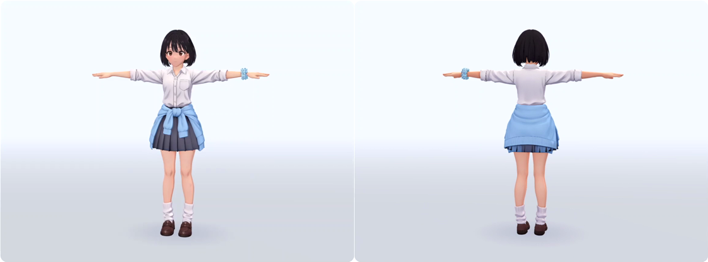

# CoderDojo 3Dダンスデモ

ゲーム制作に興味のある中学生向けのデモです。1枚のイラストから人型の3Dキャラクターを作り、同じモデルに歩行とダンスのモーションを適用しました。

制作のきっかけは、3Dキャラクターが「テトリス」を踊るXの投稿です。 [世界の凡人さんの投稿](https://x.com/Sekai_no_Bonjin/status/2108843728945483950)

## 素材

| 素材 | 内容 |
| --- | --- |
| [採用した元絵](assets/character-reference-v2.png) | 水色の腰巻きカーディガンとシュシュが目印の全身イラスト |
| [頭の4方向](assets/views/head/)・[体の4方向](assets/views/body/) | 3D候補の生成に使った入力画像 |
| [全身の3方向](assets/views/three-view/) | 頭と体を組み合わせたときの比率や向きの確認用 |
| [歩行モーション](assets/animations/coderdojo-walk.vrma) | このデモ用に制作したVRM Animation。VRMA対応ビューアーで人型VRMに適用できます |

## 制作手順

1. 元絵をもとに頭と体をそれぞれ前・後・左・右から描き、服の色や小物の左右を揃えました。
2. Tripo Studioで頭と体を各4候補生成し、きゃらくる（Charakuru）で採用した頭と体を組み合わせました。質感を調整し、人型の骨格を入れました。 [Charakuru公式配布](https://github.com/nanocle/Charakuru/releases/tag/v1.1.1)
3. Blenderで骨ごとにどの部分が動くかを調整し、髪や衣装に揺れを加えました。確認用VRMで歩行とダンスを再生し、足の接地や衣装との干渉を見ました。
4. 元絵、モデルの回転、歩行、ダンスの順に収録しました。ダンスは参照投稿で使われた八ツ橋まろんさんのVRMAを適用しました。 [「テトリス」モーション配布元](https://booth.pm/ja/items/6438933)

## 苦労した点

- 別々に生成した頭と体を合わせると、横から見た首が細く長く見えました。正面と側面を見比べ、首の長さと前側の厚みを調整しました。頭頂では髪の隙間から頭皮が見えたため、髪の覆いも見直しました。
- 歩行では足が重なり、腕を振ると手が腰の衣装に入りました。足の軌道、膝の上がり方、腰の上下動を調整し、肘と腕の振り幅も確認しました。
- ダンスの試作は参照の振り付けを再現できず、配布VRMAに差し替えました。確認版では左手が腰まわりの衣装に一瞬めり込む箇所が残りました。

## 出典と公開範囲

元絵・方向別画像は本デモ用に画像生成で制作しました。モデル制作にはTripo Studio、Charakuru、Blenderを使用しました。掲載した歩行は本デモ用に制作したモーションです。第三者のダンスモーションは配布元から入手してください。 [Tripo利用規約](https://www.tripo3d.ai/terms)・[「テトリス」モーション配布元](https://booth.pm/ja/items/6438933)

VRM・Blenderの編集データは、モデル名・作者表記・利用条件を確定するまでローカルで保管しています。ニコニコ動画への公開は保留中です。
